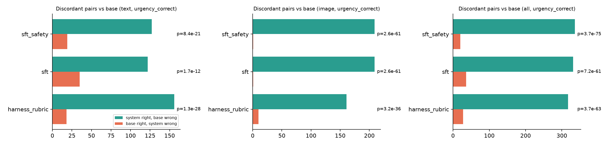
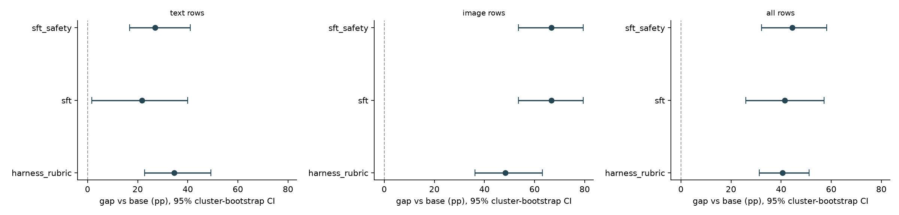

# 🐾 PawTriage

**Dog and cat symptom triage on a fine-tuned open model.** A pet owner describes a problem in plain language, optionally with a **photo or short video**, plus a pet profile. PawTriage returns an urgency tier (`emergency_now` / `vet_today` / `vet_this_week` / `monitor_at_home`), the most likely conditions (*possible, not a diagnosis*), red flags, a structured protection plan, and a recheck time. The core is a **vision LoRA of GLM 5.3 Flash trained on Fireworks serverless training**, wrapped in a deterministic safety/routing layer, a web app (intake → triage → care-plan tracker → vet handoff → follow-up), and a statistical evaluation on a locked, held-out test set.

> **Disclosure.** Owner messages are **synthetic**, generated by Kimi K3 against a vet-reference rubric. **Labels come from the rubric row, never from the generator.** They are rubric-derived, not clinical outcomes. The rubric was drafted in hours from Merck Vet Manual / ASPCA APCC / AAHA references and **has not been reviewed by a veterinarian**. PawTriage never diagnoses; it says when to see a vet and what to do until then.

## Results

**Locked test set:** 712 questions (400 text from 10 held-out scenarios, 312 photo questions from 104 held-out images). Every system uses the identical prompt (hash-asserted); the fine-tune was scored **through the deployed endpoint**. `sft_safety` = the same `sft` answers with the deterministic safety layer applied (no extra model calls), so the two differ only by the rules.

**Headline: on photos, the fine-tuned GLM 5.3 Flash gets urgency right 93.0% of the time vs 26.3% for the base model (+66.7 pp, McNemar p = 3e-61, 95% cluster-bootstrap CI [+53.5, +79.5]). With the safety layer, all rows: 87.1% vs 42.7%.**

#### All rows (text + image)
| system | urgency acc | under-triage | harmful advice | top-1 cond | plan recall | $/1k chats | p95 ms | McNemar p | bootstrap 95% CI (pp) | real gain |
|---|---|---|---|---|---|---|---|---|---|---|
| base | 42.7% | 31.7% | 0.0% | 45.4% | 46.6% | $0.330 | 2339 | — | — | — |
| harness_rubric | 83.3% | 5.8% | 0.0% | 75.6% | 83.7% | $1.019 | 3344 | 3.7e-63 | +40.6 [+31.3, +51.2] | yes |
| sft | 84.1% | 25.4% | 0.0% | 76.1% | 74.0% | $1.814 | 2386 | 7.2e-61 | +41.4 [+25.9, +57.2] | yes |
| sft_safety | 87.1% | 16.7% | 0.0% | 76.1% | 74.9% | $1.814 | 2386 | 3.7e-75 | +44.4 [+32.2, +58.3] | yes |

#### Text rows
| system | urgency acc | under-triage | harmful advice | top-1 cond | plan recall | $/1k chats | p95 ms | McNemar p | bootstrap 95% CI (pp) | real gain |
|---|---|---|---|---|---|---|---|---|---|---|
| base | 55.5% | 31.7% | 0.0% | 67.8% | 60.1% | $0.330 | 2339 | — | — | — |
| harness_rubric | 90.0% | 5.8% | 0.0% | 90.2% | 89.9% | $1.019 | 3344 | 1.3e-28 | +34.5 [+22.8, +49.2] | yes |
| sft | 77.2% | 25.4% | 0.0% | 72.8% | 66.1% | $1.814 | 2386 | 1.7e-12 | +21.8 [+1.8, +40.0] | yes |
| sft_safety | 82.5% | 16.7% | 0.0% | 72.8% | 67.7% | $1.814 | 2386 | 8.4e-21 | +27.0 [+16.8, +41.0] | yes |

#### Image rows
| system | urgency acc | under-triage | harmful advice | top-1 cond | plan recall | $/1k chats | p95 ms | McNemar p | bootstrap 95% CI (pp) | real gain |
|---|---|---|---|---|---|---|---|---|---|---|
| base | 26.3% | — | 0.0% | 16.7% | 29.3% | $0.330 | 2339 | — | — | — |
| harness_rubric | 74.7% | — | 0.0% | 56.7% | 75.8% | $1.019 | 3344 | 3.2e-36 | +48.4 [+36.2, +63.1] | yes |
| sft | 93.0% | — | 0.0% | 80.5% | 84.1% | $1.814 | 2386 | 2.6e-61 | +66.7 [+53.5, +79.5] | yes |
| sft_safety | 93.0% | — | 0.0% | 80.5% | 84.1% | $1.814 | 2386 | 2.6e-61 | +66.7 [+53.5, +79.5] | yes |

**Read this honestly:**
- **Real gains** (p < 0.05 and CI excludes 0) vs base: fine-tune and fine-tune+safety on urgency (text, image, all), top-1 condition (image, all) and image finding. Full list in `results/summary.json`.
- **On text, the rubric-in-prompt harness still beats the fine-tune** (90.0% vs 82.5% with safety; McNemar p = 0.0032 on 98 discordant pairs). Its prompt contains the full rubric, *including the rows for the held-out test scenarios*; the fine-tune never saw those scenarios. On photos the fine-tune wins (93.0% vs 74.7%).
- **Under-triage on text:** base 31.7% → fine-tune 25.4% → fine-tune + safety 16.7% (harness 5.8%). The safety-layer improvement's bootstrap CI vs base is [-22.1, -7.9] pp: only 6 high-urgency test scenarios, so it does not clear the bar. Most of the gain is xylitol (fine-tune alone 25% → 77.5% with the toxin rule).
- **Safety-layer bug found and fixed during evaluation:** rules did not fire when the model's JSON failed to parse. Fixed in `pt_safety.apply` (rules now build an emergency answer); the numbers above are post-fix. Known gap, *found by reading test failures and deliberately not patched* to avoid tuning on the test set: the xylitol regex misses "sugarfree", "candies", brand names (Orbit, Trident) and "pudding".
- Harmful advice was 0% for every system: no model emitted a never-list item, so the never-list filter is untested by this benchmark.
- **Cost:** base/harness are serverless per-token. Fireworks can't serve a LoRA serverless, so the fine-tune's $/1k is a dedicated 4×B300 ($60/h) at the throughput we measured (~33k chats/h at concurrency 16, a mostly idle GPU). It drops with utilisation or multi-LoRA sharing; it is not a like-for-like per-token number.
- **Not scored:** `sft_router` (the large router model rejected an image input; cut per the scope valve), `frontier` (no OpenRouter key), video (no labelled clips).
- Only 10 text scenarios and 8 image classes in the test set: intervals are wide by construction.




A gain is called **real** only when McNemar exact p < 0.05 **and** the 5,000-rep scenario-cluster bootstrap 95% CI excludes zero.

## How it works

| piece | file |
|---|---|
| One prompt + JSON schema + parser for every system, training and the app | `src/pt_prompt.py` |
| Rubric validation, generation, dedupe (Jaccard > 0.8), scenario split, test lock | `src/pt_data.py`, `src/pt_pipeline.py` |
| Scoring (urgency, under-triage, top-1 condition, set F1, plan recall, harmful advice, image finding) | `src/pt_score.py` |
| Systems: base, rubric-in-prompt harness, frontier, sft, sft+safety, sft+router | `src/pt_systems.py` |
| Vision LoRA on Fireworks serverless training (cookbook `sft_loop`, `glm53_flash` renderer) | `src/pt_sft.py` |
| McNemar, cluster bootstrap, charts, summary | `src/pt_report.py` |
| Guardrails (toxin + emergency-phrase overrides, never-list filter, review flag) + router | `src/pt_safety.py` |
| Video → 6 frames + 2×3 contact sheet (ffmpeg) | `src/pt_video.py` |
| Token/$ accounting (Fireworks list prices, dated) | `src/pt_cost.py`, `src/prices.json` |
| FastAPI + sqlite backend, single-file frontend | `app/backend/`, `app/frontend/index.html` |

## Run order

```bash
uv venv --python 3.11 .venv && uv pip install --python .venv -r requirements.txt
cp .env.example .env   # FIREWORKS_API_KEY (+ OPENROUTER_API_KEY for the frontier row)
# training venv (Fireworks cookbook, torch/transformers pins)
git clone --depth 1 https://github.com/fw-ai/cookbook vendor/cookbook
(cd vendor/cookbook/training && UV_PROJECT_ENVIRONMENT=../../../.venv-train uv sync --python 3.11)
```

| notebook | what | cost | time |
|---|---|---|---|
| `00_rubric_check` | validate rubric + vocab, coverage | $0 | <5 s |
| `01_generate_and_split` | ~2,000 text + ~1,400 image rows; split; human review; **lock** | $3.56 actual (Kimi K3) | ~15 min |
| `02_baseline` | base GLM 5.3 Flash, temp 0 | ~$0.30 | ~3 min |
| `03_harness` | base + full rubric in the system prompt | ~$0.75 | ~4 min |
| `04_sft` | vision LoRA, serverless training | $36.20 actual (4.07M train tokens × $8.89/M); serving deployment ≈ $17 for 17 min | ~1–1.5 h |
| `05_score_all` | every system on the locked test set (cached) | ~$1 + deployment time | ~10 min |
| `06_report` | McNemar + bootstrap + charts + summary | $0 | <1 min |

App: `.venv/bin/uvicorn app.backend.main:app --port 8031` → http://localhost:8031. With no fine-tune deployed, **Best available** serves base + rubric prompt (83% on the test set); **Base** is the untuned before/after toggle.

## Data

- **Text:** 1,879 rows from 35 rubric scenarios (`both_*` scenarios expand to dog + cat). Split **by scenario** 80/20, so no test scenario is seen in training (asserted in code); stratified so the test set has every urgency tier and both species.
- **Images (path taken: public dataset, not the Oxford-IIIT fallback):** 1,264 skin photos in 8 classes from Hugging Face `sanjayS059/Pet_disease` (dogs, MIT) and `shahida12/Russiancat-skin-disease` (cats, **no licence declared**, so hackathon use only and images are not redistributed). Classes: cat ringworm / flea allergy / scabies-mange / healthy; dog allergic / bacterial / fungal dermatosis / healthy. Owner messages for image rows use **one generic prompt for every class** ("is this spot serious?") so the text cannot leak the label.
- **Label verification:** 30-image contact sheets per class were inspected (`data/images/VERIFICATION.md`, `data/raw/verify/`). No class was dropped; 122 colour-flooded junk dog images were quarantined. **This check was done by an AI agent, not two humans.**
- **Near-duplicates:** the cat set contains rotated/flipped copies, so images are split by **dihedral-invariant dHash group**: no near-duplicate pair spans train and test.
- **Video:** frame-sampled into the image path. Human-labelled clip eval: **not yet collected**: pipeline is built and tested (`src/pt_video.py`, `scripts/build_video.py`, `vid_*` rubric rows), but no clips were labelled before submission, so there are no video numbers and the fine-tune never saw video inputs.

## Hackathon rubric: where we'd lose points

| criterion (weight) | what we have | where it would lose points |
|---|---|---|
| Benchmark (40) | Locked test set, identical prompt (hash-asserted), McNemar + cluster bootstrap for every system vs base, text/image/all splits | Synthetic messages and rubric labels; single seed; image classes come from two small public sets (dog classes 54–80 images) |
| Business (25) | Cost per 1k chats per system from real token counts; named users; open-weights argument | Value math rests on assumptions, not pilots |
| Technical (20) | Vision LoRA on serverless training, safety layer, router, video frame sampling, full app | No retraining on follow-up outcomes yet |
| Presentation (10) | 60 s demo, charts in-app | Function over polish (single-file frontend) |
| Docs (5) | This README, DECISIONS.md, LOCKED.md | — |

## Business case

**Users:** vet clinics' after-hours lines, telehealth triage nurses, and pet-care / pet-insurance apps. All of them answer "is this an emergency?" thousands of times a day.
**Value math (assumptions written out).** Measured on our test set: base GLM 5.3 Flash serverless **$0.33 / 1k chats**; base + rubric prompt **$1.02 / 1k**; fine-tune on a dedicated 4×B300 **$1.81 / 1k at the throughput we measured** (33k chats/h at concurrency 16, a mostly idle GPU; at full utilisation or with multi-LoRA sharing this falls). Assume a telehealth line doing 10k triage chats/day: that's $3–18/day in model cost for PawTriage. **We did not measure a frontier model** (no OpenRouter key), so we make no savings claim against one. The value we *can* show is accuracy per dollar on photos: 93% urgency accuracy vs 26% for the same base model at the same prompt. Under-triage is the cost that matters clinically, so we report it separately, and the safety layer only ever *raises* urgency.
**Why open weights:** an order of magnitude cheaper per chat, deployable in the clinic's own account, and patient (pet) data and photos stay with the clinic.

## Caveats

- Synthetic owner messages; labels are rubric-derived, not outcomes. The rubric was written in hours by an AI and **no vet has reviewed it**.
- The test set was locked **without** the planned two-person human review.
- One training run, one seed. English only.
- The image "healthy" classes are mostly whole-pet photos while disease classes are close-ups, so the model may partly learn framing. Dog bacterial vs fungal look alike at thumbnail size.
- Video n is small; numbers are shown with a wide interval and **no significance claim**.
- Follow-up outcomes are logged but the model has **not yet been retrained** on them.

## PawTown SF: shared pet care as a 3D game (`/pawtown`)

A household ("Den") has several caregivers (parent, co-parent, helper/dog walker) and several pets. Every game mechanic is a care behavior:

| Game mechanic | Health behavior it drives |
|---|---|
| Quests generated from each triage care plan | Plan adherence: "do now" steps, watch-fors, rechecks |
| Recheck timers over each pet (orange when overdue) | Following up before things worsen |
| Med quests with a **double-dose guard** | Two caregivers can't both give the 8 am carprofen; the second "Done" is blocked and logged |
| **Contagion mode**: a contagious finding (e.g. ringworm from a photo) adds quests for *every* pet in the Den, plus hand-washing if it can spread to people | Stops household spread |
| Shift-handoff notes | Become a "Caregiver log" section in the vet packet PDF |
| Helper view | Dog walkers see today's tasks only, not diagnoses or photos |
| **Emergency mode**: scene turns red, game pauses, route and phone for the nearest real 24h vet, poison-control line | Nothing is scored for waiting; the only thing to do is go |
| Care points and badges ("Went when it mattered", "Double dose caught", "Contagion contained") | Points only for care actions, never for staying home |
| Fog over SF clears as the Den finishes care steps | Visual progress |
| Neighborhood health weather | Anonymous contagion counts, hidden below 3 reports (privacy) |

Map: cartoon SF in Three.js (r160) with neighborhood islands at real coordinates and primitive landmarks. Vets (26, 2 tagged 24h/emergency) and dog parks (39) are **real OpenStreetMap data** (© OSM contributors, ODbL), fetched once into `data/map/sf_places.json`; no vet is invented. Hours come from OSM and may be stale, so the UI says to call ahead.
Demo: **Seed demo Den** runs one real photo triage (≈$0.001); **Demo: Pepper ate chocolate** runs one real text triage that hits the toxin rule and triggers emergency mode. Needs WebGL (headless browsers usually lack it).

### Demo views
- `/#compare`: **base vs. tuned, live.** Same photo, two real calls in parallel, each with a ⚡ Fireworks cost and latency badge (≈$0.002 per run).
- `/#replay`: **the fine-tune's recorded answers.** For locked-test-set photos, it shows base, base + rubric, LoRA and LoRA + safety side by side against the gold label. It can show wins, random photos or misses. No GPU needed.
- `/pawtown#lab`: the **Fireworks Lab** landmark in Mission Bay, showing the results table, McNemar p-values, bootstrap CIs and charts inside the game.
- **Care adherence:** % of due care steps done on time, per pet. Shown on the pet card and in the vet packet (useful for vets and insurers).
- **Dog-walker route** (`/walker/{name}`): one helper's tasks for today across every Den they belong to.
- `POST /demo/reset`: wipes the local demo database.

## Where this goes
- **Shelters and foster networks:** many animals and many volunteers is the Den model, and contagion tracking is their biggest operational problem.
- **Dog-walker businesses:** the walker route already spans Dens. Next are per-client logs and billing.
- **Vet clinic intake:** the vet packet arrives before the visit, priced per triaged visit.
- **Neighborhood outbreak alerts:** the privacy-thresholded health weather, scaled up (e.g. a parvo cluster at a dog park).
- **Specialty LoRAs on one deployment** (skin, eyes, stool), routed by the scanner, sharing one GPU's cost.
- **Insurance:** documented adherence could mean lower premiums.

## Live scanner (bonus)

To run it: clone the repo, put LiveKit + OpenAI + Gemini keys in `server/.env`, set `SCAN_ENGINE_URL=http://localhost:8031/scan`, `npm start` + `npm run worker:dev`, and open it through an HTTPS tunnel. Set `ACCESS_TOKEN` and open the link with `?key=<token>` (our patch to `web/src/App.tsx` reads the key from the link instead of baking it into the JS).

`app/backend/main.py` exposes `POST /scan`, implementing the `SCAN_ENGINE_URL` contract of [live-scanner](https://github.com/mercadobeomelo/live-scanner): a camera + voice agent that boxes the spot, takes the photo itself, and asks PawTriage for the report. PawTriage urgencies map to its red/orange/yellow/green.

**Scanner → PawTown:** if the pet name typed in the scanner matches a pet in a Den, the scan's report is saved as a case for that pet. The Den then gets quests, contagion fan-out and emergency mode on the 3D map within about 5 s, the scan is logged in the Den, and it appears in the vet packet. If the name doesn't match, the pet joins the newest Den. If no name is given, the scan stays stateless. Repeat scans refresh quests rather than duplicating them.

## Demo

See [`demo/demo_script.md`](demo/demo_script.md).
